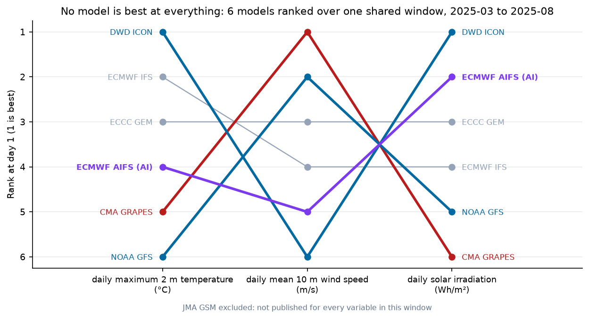

# Verifying global weather models at Chinese stations

<!-- TODO: add the tests badge only after CI is green again. As of 2026-10-25 the last
     `tests` run on main (d3fa00a) fails in scripts/check_reproducible.py: reports/leaderboard/2026-08
     no longer reproduces from data/. A red badge on the first screen is worse than none. -->
[](LICENSE)
<!-- TODO: DOI badge once a release is archived on Zenodo -->

Ten operational global models — eight physics-based and two machine-learned —
verified at a **fixed forecast lead** against Chinese station observations and
satellite-retrieved irradiance. The question is not which model wins a global
average; it is which one is closest **here**, on the variable you care about,
and how much of its error is a constant anyone could remove.

**There is no best model. There is a best model per variable, and the ranking
inverts between them.**



| Model | Temperature | 10 m wind | Solar irradiation |
|---|---|---|---|
| DWD ICON | **1** | 6 | **1** |
| ECMWF AIFS (AI) | 4 | 5 | 2 |
| ECCC GEM | 3 | 3 | 3 |
| ECMWF IFS | 2 | 4 | 4 |
| NOAA GFS | 6 | **2** | 5 |
| CMA GRAPES | 5 | **1** | 6 |

*Six models, three variables, one shared six-month window (March–August 2025),
day-1 lead.* Over the full fourteen-month archive, where only temperature and
wind exist, the same reversal appears at four control stations in London,
Frankfurt, New York and Tokyo, so it is a property of the models rather than of
China.

```bash
pip install -e ".[dev]"
make verify figures   # every table and figure, from the pairs committed in data/
make leaderboard      # the energy-province page, from the pairs committed in data/
make test
```

No network needed: the derived forecast–observation pairs (about 5 MB) are
committed under `data/`.

## Results

**Is any of it better than doing nothing?** Persistence — copy the observation
from `lead` days ago — is the baseline. On the energy-province sets, one day
ahead ([leaderboard 2026-08](reports/leaderboard/2026-08.md)):

| | Persistence | Best model | Skill | Observed mean |
|---|---|---|---|---|
| 10 m wind, 12 airports | 1.28 m/s | NOAA GFS **0.89** | **0.52** | 3.06 m/s |
| Daily irradiation, 10 PV points | 2,400 Wh/m² | ECMWF AIFS **989** | **0.83** | 6,642 Wh/m² |

Skill is `1 − MSE/MSE_persistence`. Forecasting halves the squared error on wind
and removes five sixths of it on irradiation — and NOAA GFS five days out
(1.12 m/s) is still closer than yesterday's wind (1.28).

**The machine-learned model is level on irradiation, behind on station
variables.** ECMWF AIFS, scored on its own window (183 days) with the physics
models restricted to the same days:

- Day-1 daily maximum temperature: fourth of seven; 10 m wind: sixth of seven.
  Its deficit against ECMWF IFS is significant on both (+0.22 °C and +0.11 m/s
  MAE, bootstrap intervals excluding zero).
- Day-1 solar irradiation: second of six, 1,000 Wh/m² RMSE against DWD ICON's
  999 — a tie (paired difference +11, interval −26 to +47) — and **228 Wh/m²
  better** than ECMWF IFS in MAE. By day 5 it is first outright (1,296 against
  ICON's 1,459).
- Its error grows the slowest or close to it with lead: +16.9% from day 1 to
  day 5 on temperature, against +20.6% to +45.1% for the physics models.

**A raw wind leaderboard mostly ranks calibration.** After a thirty-day rolling
offset fitted per station on earlier days only, the day-1 wind table collapses
from a 0.89–1.54 m/s spread to 0.70–0.82, and the order changes: ECMWF and ICON
have the largest offsets and the smallest error once they are removed.

**Every model runs cold on the daily maximum, and it is not a China effect.**
Biases run from −0.69 to −1.58 °C; the four control stations show a mean bias of
−0.99 °C against China's −1.10 °C.

**Changing the yardstick can invert a ranking.** Scoring 10 m wind against ERA5
instead of the anemometer, on the same 6,576 station-days, is worth 0.47 m/s to
the two ECMWF models and 0.02 m/s to the other two — and puts AIFS, which is
trained on ERA5, first instead of fourth. So 100 m wind, where ERA5 is the only
truth, is reported as unverified rather than ranked.

Full scorecards, figures and discussion:

| Page | What it covers |
|---|---|
| [docs/findings.md](docs/findings.md) | every section of the study: baseline, rank reversal, AIFS, scorecards, biases <!-- TODO: new file; draft in aiwp-china-verification.FINDINGS.md --> |
| [reports/leaderboard/](reports/leaderboard/) | monthly energy-province leaderboard: 12 wind airports, 10 PV-base points |
| [reports/mlwp.md](reports/mlwp.md) | Pangu-Weather, Aurora and GraphCast from NOAA's archive, four inland stations |
| [reports/hub_height.md](reports/hub_height.md) | 100 m wind, and what verifying against a reanalysis costs |

## Corrections

> **Corrected on 2026-09-21.** Two numbers in the leaderboard section were
> computed in ways that flattered them, and both have been recomputed. The column
> headed "with the constant offset removed" took each model's mean error out of
> the very sample it was then scored on, which no correction can achieve because
> it needs the bias before the day arrives; it is now fitted on the previous
> thirty days only, and the ranking it produces is different. And each
> per-station and per-month winner was judged on its own interval, so the page
> made a dozen or more judgements and called each of them 95%; they are now also
> reported after a Holm correction over the table a reader sees at once, and most
> of them do not survive it. The sentence "nobody running plants in several
> provinces can buy one model" rested on the uncorrected count and has been
> rewritten. Earlier wording is in the commit history.

> **Revised on 2026-10-25 (data, not method).** The irradiation half of the
> 2026-08 leaderboard was rebuilt after the satellite archive revised its own
> record: it now starts on 1 May 2026 rather than 21 May, and 3 and 4 July have
> fallen below the 22-hour rule for a usable day. On every other day the pairs
> are identical, the wind half did not change, and no scoring rule changed. The
> day-1 irradiation leader in the table above moved from ECMWF IFS (978) to ECMWF
> AIFS (989). Earlier figures are in the commit history.

## Why fixed lead is the whole study

An earlier version used Open-Meteo's historical forecast archive, which returns
the best forecast available for each hour — whatever the most recent run said, at
whatever lead. Averaging over it produces a score that describes no product
anyone can buy. This version uses the previous-runs archive, where
`temperature_2m_previous_day3` means exactly "what this model said three days
before". Every number here is at a stated lead.

- **Common sample.** Every comparison is restricted to days on which every model
  in it produced a forecast; a mean over whatever days a model ran rewards it for
  the days it skipped.
- **Paired tests.** Differences are tested as per-day differences in absolute
  error with a bootstrap over days; a model is only called better when the
  interval excludes zero.
- **Bias reported separately from error.** Two degrees cold every day and two
  degrees out at random have the same RMSE; only one is fixable with a constant.

## What it does not show

- **Airports, not cities.** METAR comes from airports on flat open ground outside
  town. Nine national stations are enough to rank models, not to map regional skill.
- **10 m is not hub height**, and 100 m wind is reported as unverified rather
  than verified against a substitute. Nothing here covers precipitation.
- **The irradiance truth is a satellite retrieval, not a pyranometer** — several
  per cent error on daily totals. Model comparisons are unaffected; absolute
  numbers are upper bounds.
- **The photovoltaic coordinates were recovered, not given**, fitted from an
  anonymised operator's generation series. One of the eight lands just outside the
  national border in eastern Myanmar and is kept and named; another, at 78.7°E,
  has satellite coverage on only 79 of the 173 days.
- **Deterministic runs only**, and GraphCast covers 37 to 59 per cent of days, so
  it is reported separately.

The full list is in [docs/findings.md](docs/findings.md#what-it-does-not-show).

## Data

| What | Source | Licence |
|---|---|---|
| Forecasts at fixed lead, 8 models, days 1–5 | [Open-Meteo previous-runs archive](https://open-meteo.com/en/docs/previous-runs-api) | CC BY 4.0, free for non-commercial use |
| Station observations, hourly METAR | [Iowa State Mesonet ASOS archive](https://mesonet.agron.iastate.edu/request/download.phtml) | public, no account |
| Satellite-retrieved irradiance, hourly | [Open-Meteo satellite radiation archive](https://open-meteo.com/en/docs/satellite-radiation-api) (Himawari, Meteosat IODC) | CC BY 4.0, free for non-commercial use |

198,333 temperature pairs and 180,518 wind pairs over 427 days
(2024-07-01 to 2025-08-31), plus 102,612 and 92,771 over the 184-day AI window
(2025-03-01 to 2025-08-31), and 45,287 irradiance pairs at eight photovoltaic
sites over the same window. Thirteen stations and eight sites. The raw archives
are not redistributed; the pairs carry the licences of what they were derived
from.

Physics models: ECMWF IFS 0.25°, NOAA GFS, DWD ICON, JMA GSM, ECCC GEM,
Météo-France ARPEGE, UKMO, and **CMA GRAPES** — the Chinese operational global
model, which does not appear in the published international comparisons.
Machine-learned: **ECMWF AIFS Single** and **GraphCast** (GFS-initialised), through
the same archive, so the lead control is identical.

Units are checked rather than assumed: the fetcher asks for m/s explicitly and
asserts that m/s came back. Irradiation is energy summed over the day:
**Wh/m², not W/m².**

Rebuilding from source is optional, slow and quota-bound:

```bash
make data     # rebuild the pairs from the archives
make energy   # extend the energy-province pairs to the end of last month
```

## Layout

```
src/aiwp/
  stations.py          stations (ICAO), PV sites, the two energy-province sets
  fetch.py             fixed-lead forecasts, METAR, daily reduction, unit guard
  verify.py            scores, common sample, paired bootstrap, lead-climate check
  build_dataset.py     fetch everything, print the coverage audit
  run_verification.py  scorecards, significance tests, cross-variable ranking
  make_figures.py      figures
  leaderboard.py       the energy-province page
scripts/check_reproducible.py   CI: every page in reports/ must recompute from data/
tests/                 expectations hand-computed
reports/               scorecards, results.json, figures, leaderboard
```

## How to cite

Cite this repository (see [`CITATION.cff`](CITATION.cff)) and the data sources
above (Open-Meteo, Iowa State Mesonet).

## Related repositories

- [cn-weather-cube](https://github.com/JoooDev-TPP/cn-weather-cube) — point weather with units attached and sources named; extracted from this study
- [green-ai-ledger](https://github.com/JoooDev-TPP/green-ai-ledger) — compute energy and carbon, with the grid factor pinned rather than guessed

## License

Code: MIT. Data: the derived pairs carry the licences of their sources, above.
